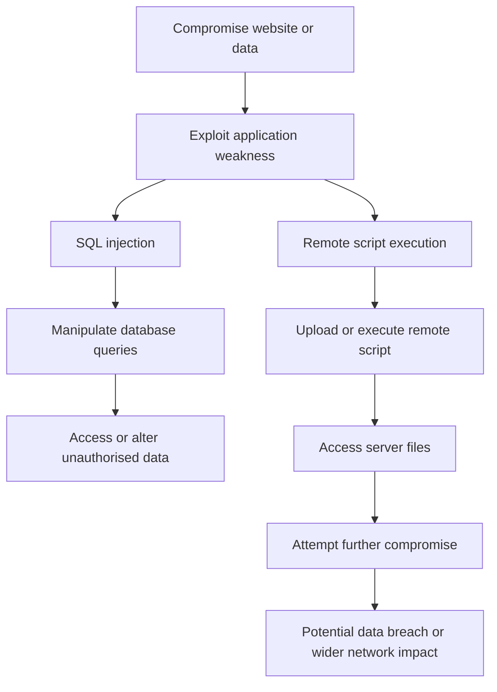
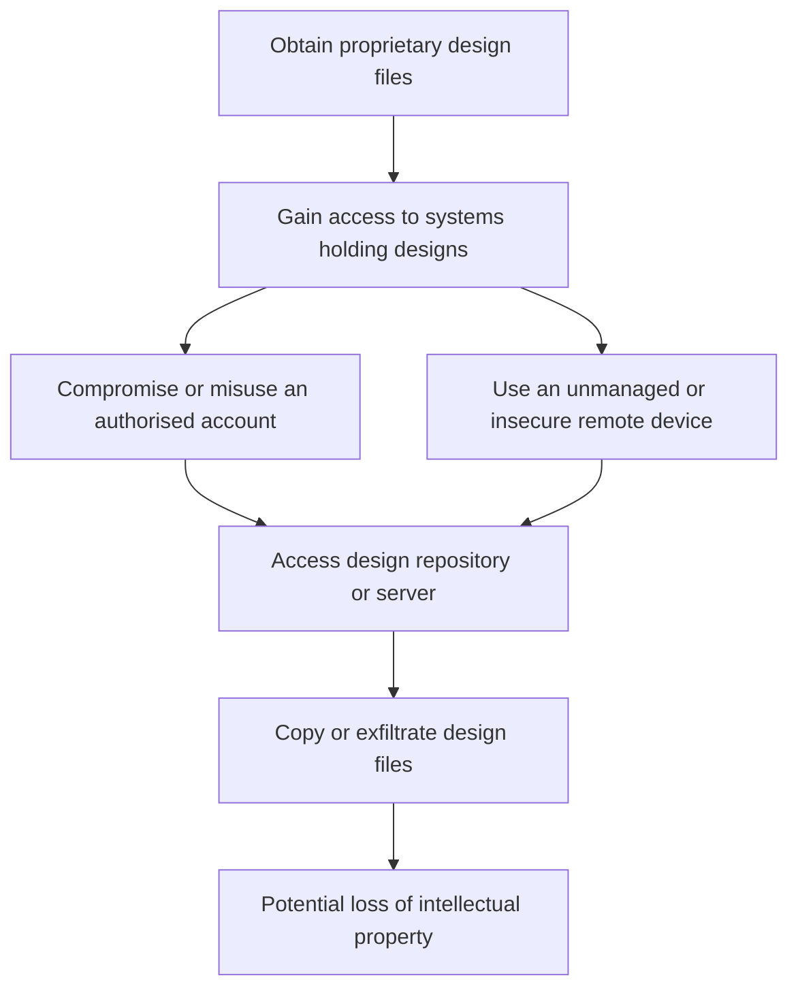
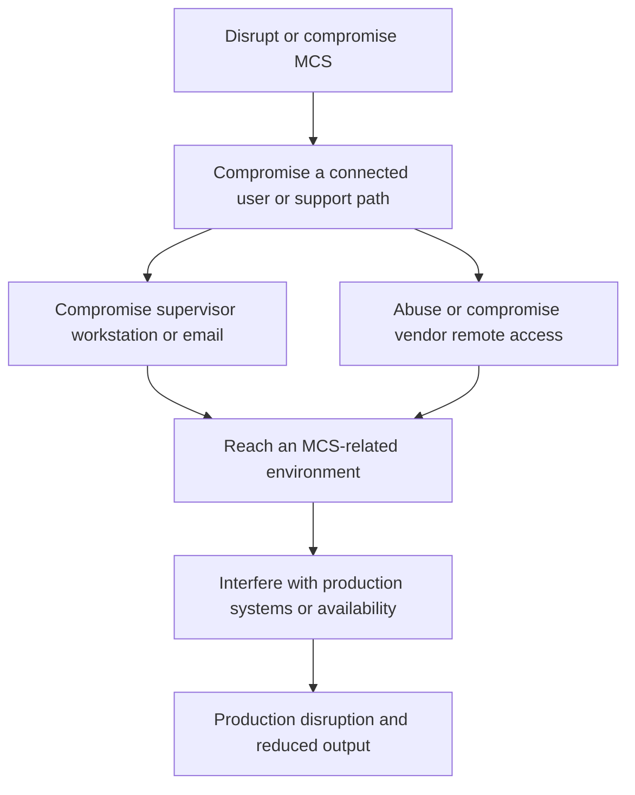

# Attack Trees

The following diagrams represent the three priority threat scenarios discussed in the case study. They are conceptual attack paths, not proof that an attack was performed or that every branch is technically feasible.

## 1. Exploit the public website

**Risk treatment:** Remediate the application; use parameterised queries and server-side validation; prevent execution in upload directories; restrict file-system permissions; segment the network; and monitor for suspicious activity.

## 2. Steal proprietary product designs

**Risk treatment:** Limit access to managed corporate devices; apply least privilege and periodic access reviews; encrypt sensitive design files; and monitor access to high-value information.

## 3. Compromise the Manufacturing Control System

**Risk treatment:** Separate email and general-purpose activity from MCS controllers; restrict and log vendor access; use approved secure remote-maintenance sessions; and define supplier security and incident-response requirements.
